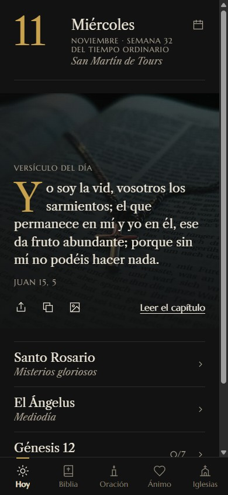
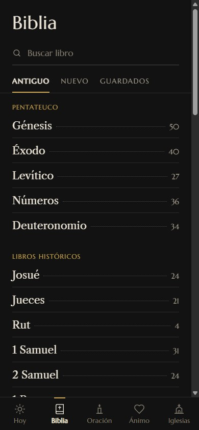
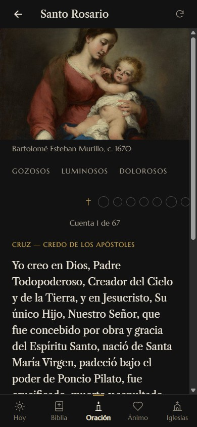
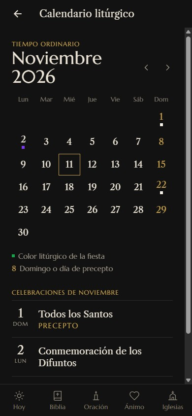

# BibliApp

App de lectura bíblica y oración: Sagrada Biblia, oraciones, rosario guiado, calendario
litúrgico, versículos por estado de ánimo y directorio de parroquias. Funciona sin
conexión y se empaqueta para Android con Capacitor.

**Demo:** https://bibliappweb.netlify.app

<p>
  
  
  
  
</p>

## Qué incluye

- **Lector:** los 73 libros, con tamaño de letra ajustable y versículos guardados.
- **Oración:** oraciones por categoría y rosario de 67 cuentas con los misterios del día.
- **Ánimo:** 500 versículos etiquetados en 15 estados de ánimo.
- **Calendario litúrgico:** tiempo litúrgico, santoral y fiestas móviles calculadas a
  partir de la fecha de Pascua.
- **Editor de imágenes:** compone una imagen con un versículo para guardar o compartir.
- **Iglesias (beta):** 22.904 parroquias con búsqueda por código postal, municipio y nombre.
- **Android:** widgets de versículo del día y versículo fijado, y avisos de días de precepto.

## Stack

Angular 21 (Signals, OnPush, rutas diferidas), TypeScript, Ionic, Capacitor, Leaflet y SCSS.
Sin servidor: todo el contenido son ficheros JSON empaquetados con la app.

## Decisiones técnicas

- **Un JSON por libro.** `BibleService` carga cada libro bajo demanda, lo guarda en caché
  y reutiliza la petición en curso si dos pantallas piden lo mismo a la vez.
- **Referencias en lugar de texto.** El dataset de ánimo guarda libro, capítulo y versículo;
  el texto sale siempre de la misma fuente.
- **Índices en memoria.** Las parroquias se indexan por código postal, municipio y palabras
  del nombre, con normalización de acentos.
- **Service worker propio.** Caché versionada en cada compilación; red primero para la
  navegación y caché primero para el resto.

## Estructura

| Ruta | Contenido |
| --- | --- |
| `app/src/app/features` | Biblia, oraciones, ánimo, calendario, iglesias y editor de versículos |
| `app/src/app/core/services` | Calendario litúrgico, versículo del día, favoritos y widgets |
| `app/src/assets` | Datos JSON, obras de arte y fotografías |
| `app/src/pwa` | Service worker y manifiesto |
| `app/scripts` | Precaché del service worker y construcción de datos |
| `app/android` | Proyecto Android con los widgets nativos |
| `web` | Portada pública con la demo embebida |

## Desarrollo

```bash
cd app
npm install
npm start
```

La app queda en `http://localhost:4200`.

```bash
npm run build:web    # compilación web con service worker
npm run build:site   # portada y app juntas en app/dist/site
```

## Texto bíblico

El texto de la Sagrada Biblia tiene derechos reservados y no se distribuye en este
repositorio. Solo se incluye `app/src/assets/bible/books.json`, con los nombres de los
libros y el número de capítulos. La demo desplegada sí incluye el texto completo.

Para ejecutar la app con contenido, coloca en `app/src/assets/bible/` un fichero por libro
llamado `bible_<id>.json`, donde `<id>` es el identificador de `books.json` (1 a 73):

```json
{ "1": [{ "v": 1, "t": "Texto del versículo" }], "2": [] }
```

Las claves son los números de capítulo; `v` es el número de versículo y `t` su texto.

## Límites conocidos

- No hay servidor: favoritos y progreso se guardan en el dispositivo.
- Iglesias está en beta: las posiciones del mapa se reparten alrededor del centro del
  código postal y no son la ubicación exacta.
- Solo existe tema oscuro.
- El buscador cubre libros, oraciones y parroquias, no el texto bíblico.

## Créditos

- Texto bíblico: Sagrada Biblia, versión oficial de la Conferencia Episcopal Española.
- Obras de arte: The Metropolitan Museum of Art, Open Access (CC0).
- Mapas: colaboradores de OpenStreetMap (ODbL).
- Códigos postales: GeoNames (CC BY 4.0).

El detalle completo está en la pantalla «Créditos y avisos legales» de la app.

## Autor

David Rubio (Drmdev)
